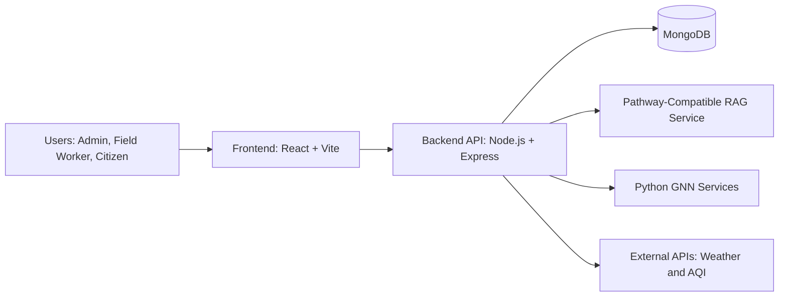
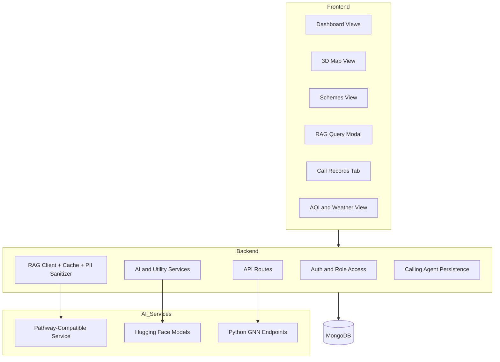
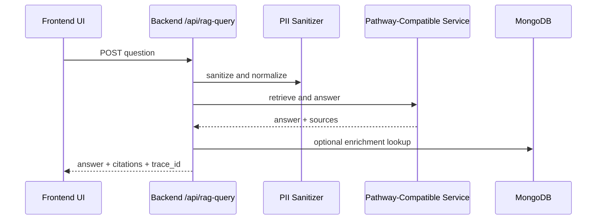
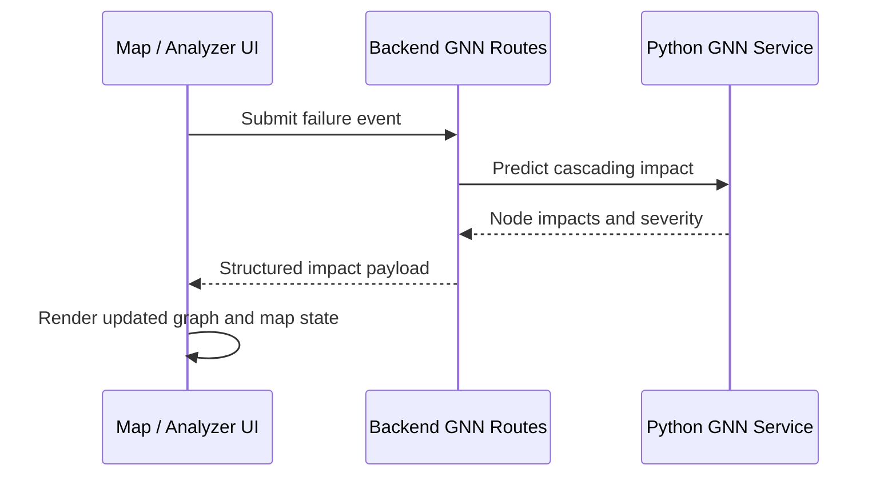

# RuraLens

RuraLens is an AI-enabled digital twin platform for monitoring public infrastructure, analyzing scheme execution, and improving citizen service delivery.

## Table of Contents

- Overview
- Core Capabilities
- Architecture
- Data and Request Flows
- Technology Stack
- Repository Structure
- Getting Started
- 3D Digital Twin (CesiumJS)
- Environment Configuration
- API Overview
- Security and Access Control
- Troubleshooting
- Contributing
- License

## Overview

RuraLens combines operational dashboards with AI services to support administrators, field staff, and citizens.

The platform focuses on:

- Real-time infrastructure visibility
- Scheme progress and discrepancy analysis
- AI-assisted question answering with citations
- Graph-based impact simulation for failure scenarios
- Citizen complaint intake, including voice-driven workflows for low-connectivity areas

## Core Capabilities

### 1. RAG Knowledge Engine

- Natural language querying over schemes, reports, and related documents
- Citation-backed answers
- Caching and rate limiting for stable response behavior
- PII sanitization before model requests

### 2. GNN Impact Forecaster

- Infrastructure represented as connected graph nodes
- Failure simulation and cascading impact estimation
- Impact scoring to prioritize mitigation actions

### 3. Discrepancy Detection

- Cross-checks between planned milestones and submitted progress artifacts
- Highlights timeline drift, budget variance, and evidence mismatches

### 4. Anonymous Issue Reporting

- Citizen-friendly complaint registration with escalation workflow support
- Designed for transparency and traceability in issue lifecycle

### 5. AI Calling Agent (Kavya)

- Voice-based complaint intake for areas with poor internet connectivity
- Registers calls as structured complaint records in the platform workflow

## Architecture

### High-Level System Diagram



### Component View



## Data and Request Flows

### RAG Query Flow



### Failure Impact Flow



## Technology Stack

### Frontend

- React 18 + TypeScript
- Vite
- Tailwind CSS
- CesiumJS (3D digital twin) and MapLibre GL (classic 2D map)
- Chart.js / react-chartjs-2
- Zustand

### Backend

- Node.js (>=18)
- Express
- MongoDB + Mongoose
- JWT-based auth
- Axios and utility middleware

### AI and Data Science Layer

- Pathway-compatible RAG service (Dockerized option available)
- Hugging Face inference integrations
- Python GNN services

## Repository Structure

```text
.
├─ backend/
│  ├─ config/
│  ├─ models/
│  ├─ routes/
│  ├─ scripts/
│  ├─ utils/
│  ├─ python-gnn/
│  └─ pathway-rag/
├─ frontend/
│  ├─ src/
│  │  ├─ components/
│  │  ├─ hooks/
│  │  ├─ services/
│  │  └─ store/
│  └─ assets/
├─ schemes/
├─ docker-compose.pathway.yml
└─ README.md
```

## Getting Started

### Prerequisites

- Node.js 18 or later
- npm
- Python 3.11 or later
- MongoDB (local or Atlas)

### Install Dependencies

```bash
# From repository root
npm install

# Backend
cd backend
npm install
```

### Run Frontend

```bash
# From repository root
npm run dev
```

### Run Backend

```bash
# From repository root
cd backend
npm run dev
```

### Optional: Run Pathway-Compatible RAG via Docker

```bash
# From repository root
docker compose --env-file backend/.env -f docker-compose.pathway.yml up -d --build
```

## 3D Digital Twin (CesiumJS)

The **Map** view opens a CesiumJS 3D city (New Delhi by default, Pune selectable) with terrain, Cesium OSM Buildings, infrastructure assets, the dependency graph used by the backend, and failure simulation. The previous MapLibre map is still available through **Classic map** in the toolbar, and the choice is remembered per browser.

### Setup

1. Create a token at [Cesium ion](https://ion.cesium.com/tokens) with access to Cesium World Terrain, Bing Maps Aerial (with labels), and Cesium OSM Buildings.
2. Put it in `frontend/.env.local` (git-ignored):
   ```bash
   VITE_CESIUM_ION_TOKEN=your-token
   ```
3. Start the backend (`cd backend && npm run dev`, port 3001) and the frontend (`cd frontend && npm run dev`, port 3000).

`VITE_*` variables are compiled into the browser bundle, so the token is a **public client credential**. In the ion dashboard, restrict it to the required assets and to your deployed domains. For Render, set `VITE_CESIUM_ION_TOKEN` on the `ruralens-frontend` service (declared with `sync: false` in `render.yaml`). CesiumJS 1.146 requires Node 22 or later to build.

Without a token the twin still runs: it uses OpenStreetMap imagery on a flat globe without terrain or 3D buildings, and says so in the UI.

### What is real and what is not

- **Datasets are synthetic.** Both the Delhi and Pune datasets are illustrative demo assets, labelled "Synthetic demo" in the UI. They are not surveyed infrastructure, and their attribute values are not live telemetry.
- **Dependency links come from the backend.** They are the edges returned by `POST /api/gnn/initialize`. The frontend draws them as returned and does not infer extra links. Proximity links (assets within about 1.5 km) are hidden by default.
- **Predictions come from `POST /api/gnn/predict-structured`.** Each result shows which engine produced it:
  - "Python GNN service": the PyTorch Geometric model service.
  - "JS fallback engine": the backend's JavaScript heuristic, which is not output from the trained GNN.
  
  Nodes the backend promoted through its rule-based "policy guidance" are flagged per node.
- **Timeline playback is a snapshot.** It replays one prediction, ordered by predicted time-to-impact. It is not a time-stepped simulation.
- **The copilot is a rule-based interpreter.** It turns a request into a typed scenario that you confirm before anything runs. No language model is connected, and all results come from the prediction backend. `ScenarioInterpreter` in `frontend/src/services/scenarioInterpreter.ts` is the integration point for an LLM-backed interpreter.

### Attribution

Cesium ion, OpenStreetMap, and imagery-provider credits appear in the strip along the bottom of the 3D view and must stay visible.

### Tests

```bash
cd frontend
npm test                                                   # unit tests
TWIN_BACKEND_URL=http://localhost:3001 npx vitest run twin.backend   # contract test against a running backend
```

## Environment Configuration

Create `backend/.env` from `backend/.env.example` and configure at minimum:

- `PORT`
- `MONGODB_URI`
- `JWT_SECRET`
- `PATHWAY_MCP_URL`
- `PATHWAY_MCP_TOKEN` (required for authenticated RAG service calls)
- `HUGGINGFACE_API_KEY` (if using HF-backed model calls)

## API Overview

### Core Endpoints

- `POST /api/auth/login`
- `GET /api/schemes`
- `POST /api/rag-query`
- `POST /api/gnn/*` (impact and graph-related routes)
- `GET /api/anonymous-reports/*`
- `GET /health`

### RAG Request Example

```json
{
        "question": "Which schemes are delayed and why?",
        "scheme_id": "sch002",
        "max_citations": 5
}
```

### RAG Response Shape (Simplified)

```json
{
        "answer": "...",
        "citations": [
                {
                        "doc_id": "sch002",
                        "snippet": "...",
                        "score": 0.91
                }
        ],
        "trace_id": "trace_...",
        "cached": false
}
```

## Security and Access Control

- JWT authentication for protected routes
- Role-aware UI and route behavior (admin, field worker, citizen)
- Request sanitization for user-provided prompts
- PII filtering prior to external model calls
- Cache and rate-limit controls on AI query routes

## Troubleshooting

### Backend fails with EADDRINUSE on port 3001

Another process is already bound to port 3001.

On Windows PowerShell:

```powershell
$conn = Get-NetTCPConnection -LocalPort 3001 -State Listen -ErrorAction SilentlyContinue
if ($conn) {
        $conn | Select-Object -ExpandProperty OwningProcess -Unique | ForEach-Object {
                taskkill /PID $_ /F
        }
}
```

Then restart backend:

```bash
cd backend
npm run dev
```

### PATHWAY_MCP_TOKEN not set warning

Set `PATHWAY_MCP_TOKEN` in `backend/.env` to match your RAG service configuration.

## Contributing

1. Create a feature branch.
2. Make focused changes with tests where applicable.
3. Open a pull request with clear scope and validation notes.

## License

This project is licensed under the MIT License.

