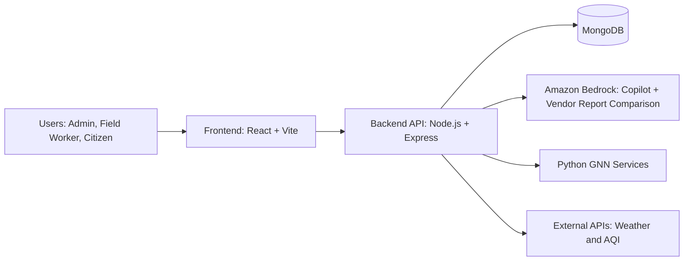
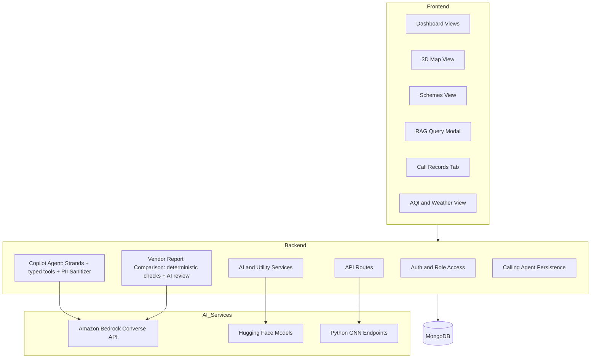
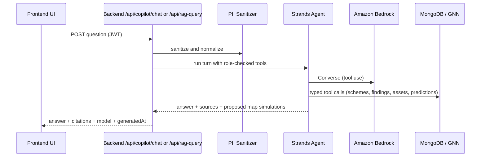
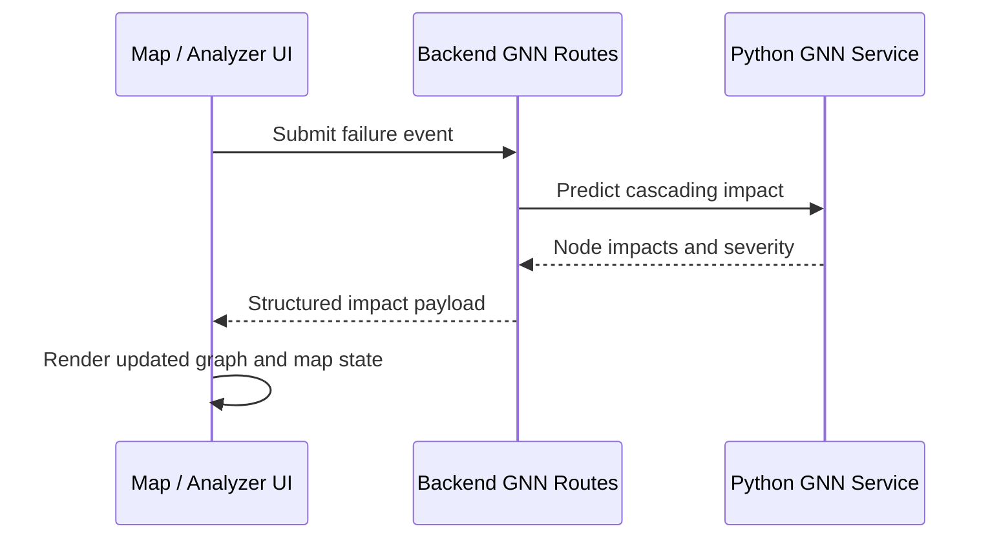

# RuraLens

RuraLens is an AI-enabled digital twin platform for monitoring public infrastructure, analyzing scheme execution, and improving citizen service delivery.

## Table of Contents

- Overview
- Core Capabilities
- Architecture
- Data and Request Flows
- Technology Stack
- Repository Structure
- Getting Started
- 3D Digital Twin (CesiumJS)
- Environment Configuration
- API Overview
- Security and Access Control
- Troubleshooting
- Contributing
- License

## Overview

RuraLens combines operational dashboards with AI services to support administrators, field staff, and citizens.

The platform focuses on:

- Real-time infrastructure visibility
- Scheme progress and discrepancy analysis
- AI-assisted question answering with citations
- Graph-based impact simulation for failure scenarios
- Citizen complaint intake, including voice-driven workflows for low-connectivity areas

## Core Capabilities

### 1. Copilot (Amazon Bedrock)

- Natural language questions about schemes, vendor report findings and the infrastructure twin
- Answers cite the records the Copilot's typed, role-checked tools actually read
- Proposes failure simulations on the 3D twin that you confirm before they run
- Caching and rate limiting; PII sanitization before model requests

### 2. GNN Impact Forecaster

- Infrastructure represented as connected graph nodes
- Failure simulation and cascading impact estimation
- Impact scoring to prioritize mitigation actions

### 3. Discrepancy Detection

- Budget, date and quantity checks calculated in code against the approved plan
- AI-assisted comparison of the plan and the vendor's progress report via Amazon Bedrock, with quoted evidence and page numbers verified against the documents
- Every finding goes to an officer for review; findings are leads, not proof of wrongdoing

### 4. Anonymous Issue Reporting

- Citizen-friendly complaint registration with escalation workflow support
- Designed for transparency and traceability in issue lifecycle

### 5. AI Calling Agent (Kavya)

- Voice-based complaint intake for areas with poor internet connectivity
- Registers calls as structured complaint records in the platform workflow

## Architecture

### High-Level System Diagram



### Component View



## Data and Request Flows

### Copilot Query Flow



The model can only call a fixed set of typed, read-only tools. It cannot run code, database queries or HTTP requests. Map simulations are returned as proposals; the user confirms them and the frontend runs them through `POST /api/gnn/predict-structured`.

### Vendor Report Comparison Flow

1. An admin uploads a vendor progress report PDF. It is stored in MongoDB GridFS and de-duplicated by SHA-256.
2. Text is extracted page by page. Scanned, empty, malformed and oversized PDFs are reported explicitly; there is no OCR.
3. Budget, date, schedule and quantity checks are calculated in code against the scheme record and plan document.
4. Only relevant excerpts are sent to Bedrock, which returns schema-validated findings. Quotes, page numbers and values are verified against the document text, and unverifiable findings are discarded.
5. Every finding (calculated or AI) is stored as `pending` review. An AI finding is a lead for review, not proof of wrongdoing.

### Failure Impact Flow



## Technology Stack

### Frontend

- React 18 + TypeScript
- Vite
- Tailwind CSS
- CesiumJS (3D digital twin) and MapLibre GL (classic 2D map)
- Chart.js / react-chartjs-2
- Zustand

### Backend

- Node.js (>=22)
- Express
- MongoDB + Mongoose
- JWT-based auth
- Axios and utility middleware

### AI and Data Science Layer

- Amazon Bedrock (Converse API) via the AWS SDK for JavaScript v3 and Strands Agents, backend only
- Hugging Face inference integrations
- Python GNN services

## Repository Structure

```text
.
├─ backend/
│  ├─ config/
│  ├─ models/
│  ├─ routes/
│  ├─ middleware/
│  ├─ scripts/
│  ├─ services/       # ai (Bedrock), copilot, documents, vendorComparison
│  ├─ test/
│  ├─ utils/
│  └─ python-gnn/
├─ docs/
├─ frontend/
│  ├─ src/
│  │  ├─ components/
│  │  ├─ hooks/
│  │  ├─ services/
│  │  └─ store/
│  └─ assets/
├─ schemes/
└─ README.md
```

## Getting Started

### Prerequisites

- Node.js 22 or later
- npm
- Python 3.11 or later
- MongoDB (local or Atlas)

### Install Dependencies

```bash
# From repository root
npm install

# Backend
cd backend
npm install
```

### Run Frontend

```bash
# From repository root
npm run dev
```

### Run Backend

```bash
# From repository root
cd backend
npm run dev
```

### Configure Amazon Bedrock

The Copilot and the AI part of vendor report comparison call Amazon Bedrock from the backend. Set `AWS_REGION` and `BEDROCK_MODEL_ID` in `backend/.env` and provide AWS credentials through the AWS SDK credential chain. Model access, the IAM policy, Render setup, costs and troubleshooting are covered in [docs/BEDROCK.md](docs/BEDROCK.md).

Without Bedrock configured the app still runs: the Copilot reports that it is not configured, and vendor reports get only the calculated checks.

### Backend Tests

```bash
cd backend
npm test   # mocked; makes no paid Bedrock calls
```

## 3D Digital Twin (CesiumJS)

The **Map** view opens a CesiumJS 3D city (New Delhi by default, Pune selectable) with terrain, Cesium OSM Buildings, infrastructure assets, the dependency graph used by the backend, and failure simulation. The previous MapLibre map is still available through **Classic map** in the toolbar, and the choice is remembered per browser.

### Setup

1. Create a token at [Cesium ion](https://ion.cesium.com/tokens) with access to Cesium World Terrain, Bing Maps Aerial (with labels), and Cesium OSM Buildings.
2. Put it in `frontend/.env.local` (git-ignored):
   ```bash
   VITE_CESIUM_ION_TOKEN=your-token
   ```
3. Start the backend (`cd backend && npm run dev`, port 3001) and the frontend (`cd frontend && npm run dev`, port 3000).

`VITE_*` variables are compiled into the browser bundle, so the token is a **public client credential**. In the ion dashboard, restrict it to the required assets and to your deployed domains. For Render, set `VITE_CESIUM_ION_TOKEN` on the `ruralens-frontend` service (declared with `sync: false` in `render.yaml`). CesiumJS 1.146 requires Node 22 or later to build.

Without a token the twin still runs: it uses OpenStreetMap imagery on a flat globe without terrain or 3D buildings, and says so in the UI.

### What is real and what is not

- **Datasets are synthetic.** Both the Delhi and Pune datasets are illustrative demo assets, labelled "Synthetic demo" in the UI. They are not surveyed infrastructure, and their attribute values are not live telemetry.
- **Dependency links come from the backend.** They are the edges returned by `POST /api/gnn/initialize`. The frontend draws them as returned and does not infer extra links. Proximity links (assets within about 1.5 km) are hidden by default.
- **Predictions come from `POST /api/gnn/predict-structured`.** Each result shows which engine produced it:
  - "Python GNN service": the PyTorch Geometric model service.
  - "JS fallback engine": the backend's JavaScript heuristic, which is not output from the trained GNN.
  
  Nodes the backend promoted through its rule-based "policy guidance" are flagged per node.
- **Timeline playback is a snapshot.** It replays one prediction, ordered by predicted time-to-impact. It is not a time-stepped simulation.
- **The copilot uses Amazon Bedrock with typed tools.** It answers from schemes, vendor findings, twin assets, dependencies and GNN predictions, and lists the sources it used. When it suggests a failure simulation, the twin shows the proposed scenario for you to confirm; nothing runs until you do, and the results come from the prediction backend, not the model. If Bedrock is not configured, the panel falls back to the local rule-based interpreter and says so.

### Attribution

Cesium ion, OpenStreetMap, and imagery-provider credits appear in the strip along the bottom of the 3D view and must stay visible.

### Tests

```bash
cd frontend
npm test                                                   # unit tests
TWIN_BACKEND_URL=http://localhost:3001 npx vitest run twin.backend   # contract test against a running backend
```

## Environment Configuration

Create `backend/.env` from `backend/.env.example` and configure at minimum:

- `PORT`
- `MONGODB_URI`
- `JWT_SECRET`
- `AWS_REGION` and `BEDROCK_MODEL_ID` (Copilot and vendor report AI comparison); optionally `BEDROCK_API=openai` with `AWS_BEARER_TOKEN_BEDROCK` to use Bedrock's OpenAI-compatible endpoint
- AWS credentials via the AWS SDK credential chain (`AWS_PROFILE` locally; see [docs/BEDROCK.md](docs/BEDROCK.md))
- `HUGGINGFACE_API_KEY` (scheme PDF field extraction and feedback analysis)

AWS values belong only in the backend environment. Never put them in `VITE_` variables, which are compiled into the public browser bundle.

## API Overview

### Core Endpoints

- `POST /api/auth/login`
- `GET /api/schemes`
- `POST /api/rag-query` (authenticated; answered by the Bedrock Copilot)
- `GET /api/copilot/status`, `POST /api/copilot/chat` (authenticated)
- `POST /api/schemes/:id/vendor-report` and review routes under `/api/schemes/:id/vendor-reports/*` (admin)
- `POST /api/gnn/*` (impact and graph-related routes)
- `GET /api/anonymous-reports/*`
- `GET /health`

### RAG Request Example

```json
{
        "question": "Which schemes are delayed and why?",
        "scheme_id": "sch002",
        "max_citations": 5
}
```

### RAG Response Shape (Simplified)

```json
{
        "answer": "...",
        "citations": [
                {
                        "doc_id": "sch002",
                        "snippet": "...",
                        "score": null,
                        "timestamp": "2026-10-11T09:30:00.000Z"
                }
        ],
        "answerSource": "amazon-bedrock",
        "model": { "provider": "amazon-bedrock", "modelId": "..." },
        "generatedAt": "2026-10-11T09:30:00.000Z",
        "trace_id": "trace_...",
        "cached": false
}
```

Citations come from the records the Copilot's tools actually read. `score` is `null` because no similarity ranking is involved. A response with `cached: true` is a stored earlier answer; `generatedAt` is when it was originally generated.

## Security and Access Control

- JWT authentication for protected routes
- Role-aware UI and route behavior (admin, field worker, citizen)
- Request sanitization for user-provided prompts
- PII filtering prior to external model calls
- Cache and rate-limit controls on AI query routes

## Troubleshooting

### Backend fails with EADDRINUSE on port 3001

Another process is already bound to port 3001.

On Windows PowerShell:

```powershell
$conn = Get-NetTCPConnection -LocalPort 3001 -State Listen -ErrorAction SilentlyContinue
if ($conn) {
        $conn | Select-Object -ExpandProperty OwningProcess -Unique | ForEach-Object {
                taskkill /PID $_ /F
        }
}
```

Then restart backend:

```bash
cd backend
npm run dev
```

### Copilot says "not configured" or AI comparison failed

At startup the backend logs whether Bedrock is configured and which credential sources it found (names only, never values). See the troubleshooting section of [docs/BEDROCK.md](docs/BEDROCK.md) for error codes such as `access_denied`, `model_not_found` and `throttled`.

## Contributing

1. Create a feature branch.
2. Make focused changes with tests where applicable.
3. Open a pull request with clear scope and validation notes.

## License

This project is licensed under the MIT License.

